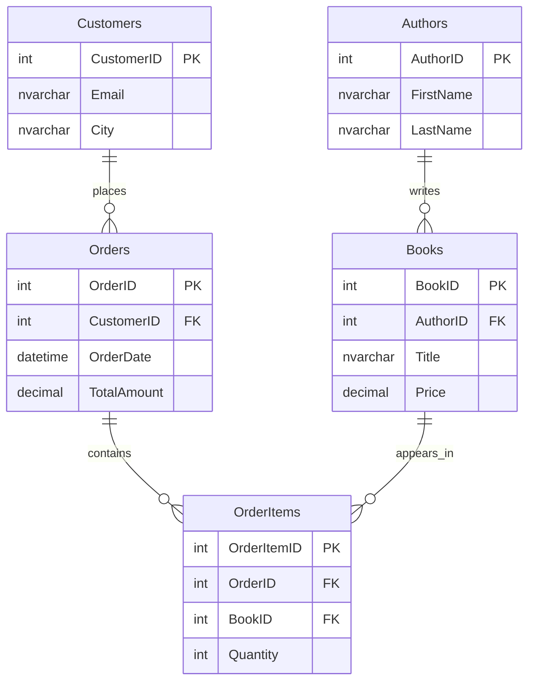

# SQL Expert: SQL Server practice material

A small learning pack for practicing T-SQL with two sample databases, a PDF guide, and an exam PDF. The SQL scripts target **Microsoft SQL Server**: they use `GO`, `IDENTITY`, `NVARCHAR`, `DB_ID`, and other T-SQL syntax.

## Start here

| File | What it contains |
| --- | --- |
| [`sql-expert.pdf`](sql-expert.pdf) | Main learning guide and SQL examples. |
| [`exam.pdf`](exam.pdf) | Exercises for checking your understanding. |
| [`OnlineBookstoreDB.sql`](OnlineBookstoreDB.sql) | Bookstore schema plus sample authors, books, customers, orders, and order items. |
| [`PracticeDB.sql`](PracticeDB.sql) | Smaller practice tables for products, sales, employees, departments, students, courses, and enrollments. |

1. Open the PDF guide and choose a database to practice with.
2. In SQL Server Management Studio or another SQL Server client that supports `GO` batches, open the corresponding `.sql` file and run it against a **local practice instance**.
3. Work through the guide, then try the exam without looking at the examples.

> **Data loss warning:** Both setup scripts drop and recreate their named databases if they already exist. `OnlineBookstoreDB.sql` also switches to `master` and uses `SINGLE_USER WITH ROLLBACK IMMEDIATE`. Review the script and use an isolated SQL Server instance before executing it.

## Bookstore schema

The bookstore script inserts a small set of books and generates 500 sample customers and 5,000 sample orders. These are synthetic records for practice, not a production dataset.

`PracticeDB.sql` is independent of the bookstore database. It includes table IDs that can be joined for exercises, but it does **not** declare foreign-key constraints between its practice tables.

## Suggested exercises

- Join `Books` to `Authors` and rank authors by number of titles.
- Calculate revenue per genre from `OrderItems` and `Books`, using `PriceAtTimeOfOrder` for historical order value.
- Find customers with no orders using a left join.
- In `PracticeDB`, compare product stock with recorded sales and identify employees without a matching department.

## License

See the repository's [`LICENSE`](LICENSE) file.
